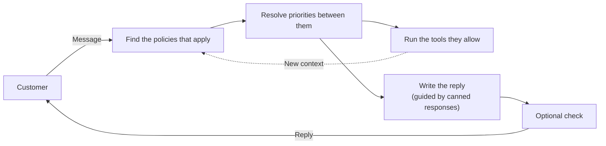

<div align="center">
<p>
<a href="https://trendshift.io/repositories/12768">
  
</a>
</p>
<picture>
  <source media="(prefers-color-scheme: dark)" srcset="https://github.com/emcie-co/parlant/blob/develop/docs/LogoTransparentLight.png?raw=true">
  
</picture>

### Vibe-code your own customer experience agent: better, faster, for a fraction of the cost.

<p>
  <a href="https://pypi.org/project/parlant/"></a>
  
  <a href="https://opensource.org/licenses/Apache-2.0"></a>
  <a href="https://discord.gg/duxWqxKk6J"></a>
  
</p>

<p>
  <a href="https://www.parlant.io/docs/quickstart/installation"><b>Quickstart</b></a> &bull;
  <a href="https://www.parlant.io/docs/comparisons/overview">Compare</a> &bull;
  <a href="https://www.parlant.io/docs/sdk/overview">Docs</a> &bull;
  <a href="https://www.parlant.io/dashboard">Dashboard</a> &bull;
  <a href="https://discord.gg/duxWqxKk6J">Discord</a>
</p>

<p>
  <a href="https://zdoc.app/de/emcie-co/parlant">Deutsch</a> |
  <a href="https://zdoc.app/es/emcie-co/parlant">Español</a> |
  <a href="https://zdoc.app/fr/emcie-co/parlant">Français</a> |
  <a href="https://zdoc.app/ja/emcie-co/parlant">日本語</a> |
  <a href="https://zdoc.app/ko/emcie-co/parlant">한국어</a> |
  <a href="https://zdoc.app/pt/emcie-co/parlant">Português</a> |
  <a href="https://zdoc.app/ru/emcie-co/parlant">Русский</a> |
  <a href="https://zdoc.app/zh/emcie-co/parlant">中文</a>
</p>

</div>

**Parlant** is a vibe-coding platform for chat agents that talk to customers. You describe how the agent should behave, and your coding agent implements it for you. Parlant provides the rest: an engine that keeps the agent on your rules in every conversation, plus the parts every customer-facing agent needs, from a chat widget and human handoff to testing and hosting.

Because the agent runs on your own code, it can use any system you can reach and any model you choose, and—unlike closed CX platforms—you pay model providers directly instead of an [overpriced fee per resolution](https://hansvandam.substack.com/p/false-containment-how-your-best-dashboard).

## What building with Parlant feels like

Imagine you're working on a lead-generation agent for your company's website, and a new feature launches in 1 hour.

- **Monday, 8:43:** Marketing sends you the final FAQ for the new **Pro** plan, which launches at 10:00.
- **8:45:** You tell your local coding agent: *"Make it answer Pro questions from this FAQ. If a Basic customer hits their project limit, mention Pro once. Never pitch it to Pro customers."* Then you go make a coffee.
- **9:00:** Your coding agent adds a [policy](https://www.parlant.io/docs/customizing-behavior/policies) and uses each customer's [plan](https://www.parlant.io/docs/core-concepts/customers#variables) to decide when Pro is relevant.
- **9:01:** You tell your coding agent: *"Test it with two simulated personas: a Basic customer at their project limit, and a Pro customer."* While they run, you grab a cookie.
- **9:10:** You open the two test sessions on the [Dashboard](https://www.parlant.io/dashboard) and check that they went as you expected: the Basic customer hears about Pro once, and the Pro customer never does.
- **9:15:** You push the change. At 10:00, your agent is ready for launch-day questions.

The lead-generation agent is ready for launch day, with no vendor ticket, no fiddling in deep menus, and no engineering sprint.

## Get properly introduced

Paste this prompt into your favorite agent:

```text
Read https://www.parlant.io/llms.txt first. Then ask me what I'd like to know and—as needed—follow up on what Parlant is, how it differs from other products, including black-box agents, and in what cases it is a better fit for one's customer-facing use case. It's a conversation.
```

When you're ready to build, the [quickstart](https://www.parlant.io/docs/quickstart/installation) gives you a prompt that has your coding agent install Parlant and set up an example agent or your own, one step at a time. From there, [take it live](https://www.parlant.io/docs/quickstart/deployment-guide) on the Dashboard's managed hosting and [put it on your site](https://www.parlant.io/docs/quickstart/frontend-integration) with the chat widget.

<details>
<summary><b>Prefer to write the code yourself?</b></summary>

<br>

Install Parlant and set a key for the default OpenRouter provider. Then, in the [Dashboard](https://dashboard.parlant.io), create a **Local development** project and set its project token:

```bash
pip install parlant
export OPENROUTER_API_KEY="<YOUR_API_KEY>"
export PARLANT_DASHBOARD_PROJECT_TOKEN="<YOUR_PROJECT_TOKEN>"
```

Create `main.py`:

```python
import asyncio

import parlant.sdk as p

ORDERS = {
    "1234": "shipped with UPS, tracking 1Z999AA10123456784, arriving Thursday",
    "5678": "still being packed, expected to ship tomorrow",
}


@p.tool
async def check_order_status(order_id: str) -> p.ToolResult:
    """Look up an order's current status."""
    status = ORDERS.get(order_id)
    if status is None:
        return p.ToolResult(data=f"There's no order {order_id}. Ask the customer to check the number.")
    return p.ToolResult(data=f"Order {order_id} is {status}.")


async def main() -> None:
    async with p.Server() as server:
        agent = await server.create_agent(
            id="support",
            name="Homeware Support",
            instructions="You help customers of an online homeware store. Be warm and concise.",
        )

        # Approved wording the agent follows when this policy applies
        late_order = await agent.create_canned_response(
            "I'm sorry it's taking longer than expected. Let me check where it is right now.",
            note="Apologize once, then get straight to the order's status.",
        )

        # A policy is plain language; Parlant brings it in only when it's relevant
        await agent.create_policy(
            title="Order status",
            content=(
                "When a customer asks where an order is, ask for the order number "
                "if they haven't given it, look it up with check_order_status, and "
                "give the status. Give delivery dates as estimates, never as promises."
            ),
            tools=[check_order_status],
            canned_responses=[late_order],
        )


if __name__ == "__main__":
    asyncio.run(main())
```

Run it with `python main.py`. Back in the Dashboard, click **Check connection**, then **Open project**. On the **Overview** page, click **New session** and ask where order 5678 is. The agent looks it up and tells you it ships tomorrow. Ask about an order that doesn't exist, and it asks you to check the number.

For a full project, run `parlant init my-agent --scaffold retail-store` (a working support agent), `--scaffold lead-gen` (a website agent that qualifies visitors and books meetings) or `--scaffold basic` (an empty one). Parlant also supports OpenAI, Anthropic, Gemini, LiteLLM, and custom providers; see [Configuring Models and Providers](docs/providers.md).

</details>

## Why it actually works

Writing the new rule took you minutes. The hard part is making sure your agent follows it correctly and consistently: with a customer who changes the subject, mixes different topics, or turns out to be on a different plan than they think.

That's where Parlant's got your back! Customer-facing agents face pressures that assistant-style agents never do:

| | AI Assistant | Customer-Facing Agent |
|---|---|---|
| **Who uses it** | A cooperative, informed user | A possibly confused, impatient, or hostile customer |
| **Cost of a mistake** | A retry or a revised draft | Financial losses, brand damage, and customer relationships |
| **Supervision** | The user corrects it iteratively | Nobody is there to catch mistakes during the interaction |
| **Structure** | Conversation is led by the user | The agent must often stick to specific operating procedures |
| **Language** | Free to improvise | On-policy at all times, sometimes with exact wording |
| **Accountability** | Nice to have on occasion | Behavior must always be explainable |

Most AI frameworks, and the code a coding agent writes on top of them, are built for that left column: for assistant agents. Parlant is built for the right column. If your coding agent suggests a general agent framework, see how Parlant compares with [LangGraph](https://www.parlant.io/docs/comparisons/langgraph), [Mastra](https://www.parlant.io/docs/comparisons/mastra), [Agno](https://www.parlant.io/docs/comparisons/agno), the [Claude Agent SDK](https://www.parlant.io/docs/comparisons/claude-agent-sdk), [Google ADK](https://www.parlant.io/docs/comparisons/google-adk), and the [OpenAI Agents SDK](https://www.parlant.io/docs/comparisons/openai-agents-sdk).

## What you get out of the box

A customer-facing agent needs much more than a model and a prompt. Parlant ships it, so your coding agent builds on it instead of inventing it:

- **[Agentic orchestration](https://www.parlant.io/docs/customizing-behavior/policies):** brings in the relevant policies as the customer's needs change, without predefined conversation paths.
- **[Tool](https://www.parlant.io/docs/ensuring-reliability/tool-reviews) and [message validation](https://www.parlant.io/docs/ensuring-reliability/message-reviews):** checks actions such as refunds before they run, and replies before they're sent.
- **[Canned responses](https://www.parlant.io/docs/customizing-behavior/canned-responses):** approved wording examples that your agent adapts to each conversation.
- **[Adaptive effort](https://www.parlant.io/docs/customizing-behavior/adaptive-effort):** spends more on a turn only when your rules recognize a high-stakes moment.
- **A [chat widget](https://www.parlant.io/docs/quickstart/frontend-integration)** for your website or app, and **[human handoff](https://www.parlant.io/docs/recipes/human-handoff)** to your team in the same chat.
- **Simulated test conversations**, **[conversation analytics](https://www.parlant.io/docs/recipes/session-analytics)**, and **[observability](https://www.parlant.io/docs/ensuring-reliability/debugging)** that links each reply to the policies, tool calls, and checks behind it.
- **[Managed hosting](https://www.parlant.io/docs/quickstart/deployment-guide)** on the Dashboard, deployed from GitHub, or self-hosted anywhere.
- **[Any model](https://www.parlant.io/docs/engine-advanced/model-routing)** from any provider, paid at the provider's price with no markup, and any system your code can reach.

See [all of Parlant's features](https://www.parlant.io/docs/sdk/overview).

## Parlant vs a closed CX platform

Closed CX platforms such as Intercom Fin, Sierra, and Decagon let you build an agent through their settings, and run it for you. With Parlant, your coding agent does that work, on code you own.

| | Closed CX platform | Parlant |
|---|---|---|
| **Building the agent** | Click through the platform's settings | Describe it; your coding agent builds and tests it |
| **What it can do** | What the settings offer | Anything your code can do, in any system it can reach |
| **Models** | The vendor's | Yours, chosen per job |
| **Pricing** | [Per conversation or per resolution](https://hansvandam.substack.com/p/false-containment-how-your-best-dashboard) | Free and open source; you pay model providers directly, and the Dashboard is a flat monthly fee |
| **Your data** | On the vendor's platform | Where you choose |

If you're comfortable experimenting with a coding agent, Parlant is the better choice. If you'd rather not build with one yet, a closed platform is. Read the comparisons with [Intercom Fin](https://www.parlant.io/docs/comparisons/intercom), [Sierra](https://www.parlant.io/docs/comparisons/sierra), [Decagon](https://www.parlant.io/docs/comparisons/decagon), and [Wonderful](https://www.parlant.io/docs/comparisons/wonderful).

## How it works

You build one agent and give it a catalog of policies, procedures, tools, and canned responses. On every turn, Parlant works out which of them the conversation has made relevant and puts only those in front of the model. Customers can change topic mid-sentence or ask two things at once, and the agent keeps the right rules in view, with no paths to predefine and no handoffs between sub-agents.



Adding policies makes the agent more capable without asking the model to pay equal attention to everything at once. Read more about [policies and procedures](https://www.parlant.io/docs/customizing-behavior/policies), [canned responses](https://www.parlant.io/docs/customizing-behavior/canned-responses), [checks on replies](https://www.parlant.io/docs/ensuring-reliability/message-reviews) and [actions](https://www.parlant.io/docs/ensuring-reliability/tool-reviews), and the [agent architecture](https://www.parlant.io/docs/core-concepts/agent-architecture).

## What users say

Parlant runs customer conversations for banks, energy companies, and startups.

> *With other frameworks we've tried, precision wasn't good enough.*
> — **Sarthak Dalabehera**, Principal Engineer, slice (customer service for 18 million banking clients)

> *I am particularly impressed by Parlant's consistency, which eliminates the unpredictability often found in AI tools. The speed at which we saw value was truly remarkable.*
> — **Arpit Parashar**, Deputy Manager, Greenko Group

> *We tested Parlant extensively. The failure patterns that exist in our production logs, capturing them in Parlant takes minutes.*
> — **Vishal Ahuja**, ML Tech Lead, JPMorgan Chase

## Is Parlant for you?

Parlant is a strong fit if you own a customer experience, as a PM, conversation designer, CX lead, or developer, and you want:

- **An agent that follows your policies**, even when customers mix topics or push back.
- **Connections to your own systems**, not only a vendor's connector catalog.
- **A running cost far below a closed CX platform's**, with no [fee per resolution](https://hansvandam.substack.com/p/false-containment-how-your-best-dashboard).
- **Changes in minutes**, made by describing them to your coding agent.

It's the wrong fit if nobody on your team is ready to build with a coding agent yet (a closed CX platform fits better until you are), if the agent isn't customer-facing (for coding agents, internal assistants, or long-running automated processes, use a general agent framework), or if the agent's own logic must live in a non-Python codebase (Parlant runs as a Python service that any stack talks to over HTTP, but its behavior is written in Python).

## Free, open source, and SOC 2 compliant

- **The framework is free.** Apache 2.0, with no usage limits. You pay your model provider directly, and Parlant never marks up inference.
- **The [Dashboard](https://www.parlant.io/dashboard)** is where you test, host, and monitor your agents. It's a flat monthly fee per workspace, and free for development. It's SOC 2 Type II compliant. See [pricing](https://www.parlant.io/pricing).

## Community

- [Join Discord](https://discord.gg/duxWqxKk6J) for help and discussion.
- Use [GitHub Issues](https://github.com/emcie-co/parlant/issues) for bug reports and feature requests.
- Read [CONTRIBUTING.md](CONTRIBUTING.md) to contribute.

If Parlant helps you build a better agent, [give it a star](https://github.com/emcie-co/parlant). It helps others find it.

## License

Parlant is licensed under Apache 2.0 and is free for commercial use.

---

<div align="center">

**[Start the quickstart](https://www.parlant.io/docs/quickstart/installation)** &bull;
**[Compare with your platform](https://www.parlant.io/docs/comparisons/overview)** &bull;
**[Join Discord](https://discord.gg/duxWqxKk6J)**

Built by the team at **[Emcie](https://emcie.co)**

</div>
