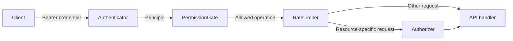

# Authentication & Authorization

This document explains how Parlant's auth infrastructure works and how to
set it up step by step — including wiring it to your existing customer database.

## Key concepts

You do not need to be a cryptography expert to configure Parlant authentication.
The central idea is that a caller presents a credential, Parlant verifies who
the caller is, and then independently decides what that caller may do.

### What happens to an authenticated request



In practical terms:

1. The client sends a credential in the HTTP header
   `Authorization: Bearer <credential>`. That credential may be an admin API
   key, a Parlant guest token, or a customer JWT.
2. The **authenticator** verifies the credential and resolves it to a
   **principal**: anonymous, guest, customer, or admin. This is
   **authentication** — determining who is calling.
3. The **permission gate** checks whether that kind of principal may perform
   the requested operation at all. This is the first part of
   **authorization** — determining what the caller may do.
4. The **rate limiter** checks whether the caller is making that operation too
   frequently.
5. For an operation on a particular session, the **authorizer** checks whether
   the principal owns that resource. For example, a valid customer may read
   their own session but not another customer's session.

Authentication and authorization are deliberately separate. A token can be
perfectly valid while the requested action is still forbidden; that distinction
is why failed authentication returns HTTP 401 while failed authorization
returns HTTP 403.

### Tokens, signatures, and keys

| Term | What it means here |
|---|---|
| **Bearer credential** | A value the client sends with each request. “Bearer” means possession is sufficient to use it, so it must be protected in transit and at rest. It is a transport convention, not a token format: both JWTs and the static admin key are sent this way. |
| **JWT (JSON Web Token)** | A compact token containing a header, a set of claims, and a signature. Parlant uses JWTs for customers and guests. The JWTs described here are signed, not encrypted; their claims can be decoded by the holder and must not contain secrets. |
| **Claim** | A field inside a JWT. Parlant requires `sub` as the customer or guest identity, checks `exp` when it is present, and uses `typ` to distinguish its own guest tokens. Other claims are copied into `Principal.attributes` for custom permission gates and authorizers. Customer tokens should always have a short expiry. |
| **Signature** | Cryptographic proof that a trusted issuer created the token and that its contents have not changed. A signature protects integrity and authenticity, not confidentiality. Parlant rejects a token if its signature or expiry is invalid. |
| **HMAC / HS256, HS384, HS512** | A symmetric signing method: the issuer and Parlant share the same secret, which is used both to sign and verify tokens. Configure this customer-token path with `customer_jwt_secret`. Parlant also signs guest tokens with HS256 using `guest_token_secret`. |
| **Asymmetric signing / RS256 or ES256** | The issuer signs with a private key and Parlant verifies with the corresponding public key. The private key never needs to be shared with Parlant. RSA algorithms use the `RS` prefix; elliptic-curve algorithms use `ES`. |
| **JWKS (JSON Web Key Set)** | A JSON document containing an issuer's public verification keys. With `customer_jwks_url`, Parlant reads the token's key ID, obtains the matching public key from that URL, and verifies RS- or ES-signed customer JWTs. This is the usual choice when an existing identity provider issues the tokens and rotates its keys. |
| **Identity provider (IdP)** | The system that logs users in and issues credentials, such as an OIDC/SSO provider or your own backend. Parlant is not an IdP: it trusts customer identity only after verifying the token issued by your system. |
| **TTL and expiration** | A token's time to live. The `exp` claim makes a JWT stop working after a particular time. Short customer-token lifetimes limit exposure; the frontend obtains replacements from your identity system, not from Parlant. |
| **Revocation and key rotation** | Ways to invalidate credentials. Parlant keeps no customer-token block-list and does not consult an IdP revocation list. Use short expirations or rotate/remove signing keys to invalidate issued JWTs; use a custom introspecting `Authenticator` if individual tokens must be revoked immediately. JWKS lets an IdP publish new public keys during rotation. |
| **API key** | The static admin credential configured as `admin_api_key`. It is not a JWT and has no claims or built-in expiry. Treat it like a database password and use it only from trusted backends. |

There are two alternative ways to verify customer JWTs:

- Use **HMAC** when your backend mints a dedicated Parlant token and can safely
  share a signing secret with Parlant.
- Use **JWKS** when an existing IdP already issues asymmetric JWTs. The IdP
  retains its private key and Parlant needs only its public JWKS endpoint.

These choices apply only to customer tokens. Parlant always mints its own guest
tokens with HS256, while the admin credential is a static API key.

### Terms used in advanced integrations

| Term | Where it fits |
|---|---|
| **RBAC (role-based access control)** | Grants operations according to roles such as support agent or auditor. Implement it by replacing `PermissionGate` and reading roles from `Principal.attributes`. |
| **Scope** | A token claim naming an allowed capability, such as `sessions:read`. A custom `PermissionGate` can enforce scopes instead of, or alongside, roles. |
| **OIDC / SSO** | Common identity and sign-on systems that authenticate users and often issue signed JWTs. Configure their JWKS URL when their tokens already have a suitable `sub`, or adapt them with a custom `Authenticator`. |
| **mTLS** | Mutual TLS, where the client also presents a certificate during the TLS handshake. Supporting it requires a custom `Authenticator` that converts the verified certificate identity into a principal. |
| **Opaque token and introspection** | An opaque token is an identifier with no locally verifiable claims. Introspection means asking its issuer whether it is valid and who it represents. This also requires a custom `Authenticator`. |

## The model

Parlant distinguishes three questions, answered by three swappable ports:

| Question | Port | default |
|---|---|---|
| **Who is calling?** | `Authenticator` | `TokenAuthenticator` — stateless bearer tokens |
| **May this *kind* of caller do this operation?** | `PermissionGate` | `DefaultPermissionGate` — per-principal allowlist |
| **May this caller touch this *specific* resource?** | `Authorizer` | `OwnershipAuthorizer` — session ownership |

Every request resolves to exactly one **`Principal`**:

- **`AnonymousPrincipal`** — no credentials. May only read agent info and start
  a guest conversation.
- **`GuestPrincipal`** — an unidentified browser holding a Parlant-minted guest
  token. All guests share the singleton `guest` customer, but each guest token
  carries a random `guest_instance_id` that scopes it to *the sessions it created*.
  One guest can never read another guest's conversation.
- **`CustomerPrincipal`** — a specific customer, proven by a JWT that **your**
  backend minted (Parlant only verifies it). Scoped to that customer's own
  sessions.
- **`AdminPrincipal`** — full API access (entity creation, configuration,
  everything), proven by a static API key.

Principals also carry an open `attributes` map (the JWT's claims), which custom
gates/authorizers may consult — the defaults ignore unknown attributes.

### Guest identity lifecycle

Clients without a customer account enter a guest conversation through a
two-stage identity lifecycle. Before Parlant has issued any credentials, the
client is anonymous and requests cannot be associated with one another. Once
Parlant issues a guest token, the client has a stable pseudonymous identity
without becoming a known, logged-in customer.

The lifecycle begins as follows:

1. A new browser calls `POST /sessions` without an `Authorization` header, so
   the request resolves to `AnonymousPrincipal`.
2. Parlant creates a new `guest_instance_id`, creates the session under the
   singleton `guest` customer, and returns a guest token in the
   `X-Parlant-Guest-Token` response header.
3. The browser stores that token and sends it as
   `Authorization: Bearer <token>` on subsequent requests.
4. Those requests resolve to `GuestPrincipal`. The guest can read and message
   the sessions created with its token, and can create additional sessions
   owned by the same guest identity.

Anonymous callers cannot access any existing session, even if they know its
ID. Guest callers can access only sessions tagged with their own
`guest_instance_id`; they cannot access another guest's sessions or a named
customer's sessions. Although every guest session has `customer_id="guest"`,
the private instance ID is what establishes ownership between different guest
browsers.

A missing token resolves to `AnonymousPrincipal`. A token that is present but
invalid, tampered with, or expired instead fails authentication with HTTP 401;
it does not silently downgrade to anonymous.

### Statelessness — why there are no refresh tokens

Parlant stores **no token state whatsoever**. Every request is judged solely
on the token it presents:

- Customer tokens are issued, refreshed, and expired by **your** systems.
  Parlant cannot "block" a customer: an expired token is rejected with 401, and
  the very next request with a fresh token succeeds.
- Guest tokens are signed (HS256) by Parlant with a configurable TTL (default
  one week) — no server-side session record.
- Revocation, when you need it, lives in *your* identity system (short TTLs,
  key rotation), not in a Parlant block-list.

### HTTP status codes

- **401 Unauthorized** — the credentials failed verification (bad signature,
  expired, unknown customer).
- **403 Forbidden** — valid identity, but the operation or resource is not
  allowed (e.g. a customer reading another customer's session).
- **429 Too Many Requests** — rate limit exceeded (per client IP by default;
  admins are exempt).

---

## Quick start (SDK)

```python
import parlant.sdk as p

async with p.Server(
    auth=p.AuthConfig(
        admin_api_key="your-long-random-admin-key",
        customer_jwt_secret="secret-shared-with-your-backend",  # HS256
        guest_token_secret="another-long-random-secret",
        auto_provision_customers=False,
    ),
) as server:
    ...
```

This is the whole setup. The API now enforces the guest/customer/admin model described above.

`AuthConfig` fields:

| Field | Meaning |
|---|---|
| `admin_api_key` | Static key for full API access. **Required.** |
| `customer_jwt_secret` | Shared HMAC secret for verifying your backend's customer JWTs (HS256/384/512). |
| `customer_jwks_url` | *Alternative* to the shared secret: your IdP's JWKS URL for asymmetric JWTs (RS256/ES256 etc.). Mutually exclusive with `customer_jwt_secret`. |
| `guest_token_secret` | Secret for Parlant-minted guest tokens. If unset, a temporary one is generated at startup; guest tokens then stop working when the server restarts, so a restart logs guests out. |
| `auto_provision_customers` | If `True`, a valid customer JWT whose `sub` is not yet a Parlant customer creates that customer on first contact. Default `False` (unknown customers are rejected with 401). |

Leaving both `customer_jwt_secret` and `customer_jwks_url` unset disables
customer authentication entirely (guests + admin only).

### Configuring through the environment

Setting `PARLANT_ENV=production` makes the server read the same configuration
from environment variables and **fail fast at startup** if the admin key is
missing:

```bash
export PARLANT_ENV=production
export PARLANT_ADMIN_API_KEY="your-long-random-admin-key"          # required
export PARLANT_CUSTOMER_JWT_SECRET="secret-shared-with-backend"    # or:
# export PARLANT_CUSTOMER_JWKS_URL="https://idp.example.com/.well-known/jwks.json"
export PARLANT_GUEST_TOKEN_SECRET="another-long-random-secret"     # recommended
export PARLANT_AUTH_AUTO_PROVISION_CUSTOMERS=false
```

Without `PARLANT_ENV=production` (development mode), everything is allowed —
no credentials needed. Never expose a development-mode server publicly.

---

## Step-by-step: customer auth with your existing customer DB

Parlant is **not** an identity provider. Your backend already knows who's
logged in; it vouches for that identity by minting a small JWT that Parlant
verifies. Three steps:

### Step 1 — Make your customers known to Parlant

The JWT's `sub` claim must be a Parlant `CustomerId`. Pick ONE of:

**(a) Sync your users into Parlant** (explicit ids let `sub` be your own user id):

```python
async with p.Server(auth=...) as server:
    agent = await server.create_agent(id="my-agent", name="Support", instructions=...)
    # e.g. on your user-created webhook, or a one-time backfill:
    await server.create_customer(name="Jane Doe", id="user_1234")
```

**(b) Auto-provision** — set `auto_provision_customers=True` and skip the sync:
the first request with a valid JWT for an unknown `sub` creates the customer
(using the JWT's `name` claim if present). Best when Parlant is the system of
record only for conversations, not for customer profiles.

**(c) Bring your own `CustomerStore`** — if you want Parlant to read customer
profiles *live from your DB* instead of copying them, implement the
`CustomerStore` interface and plug it into the server:

```python
class MyDBCustomerStore(p.CustomerStore):
    async def read_customer(self, customer_id: p.CustomerId) -> Customer:
        row = await my_db.get_user(customer_id)
        if row is None:
            raise ItemNotFoundError(item_id=UniqueId(customer_id))
        return Customer(
            id=customer_id,
            creation_utc=row.created_at,
            modified_utc=row.updated_at,
            name=row.display_name,
            metadata={"tier": row.plan},
            groups=[],
        )
    # ...implement the remaining CustomerStore methods...

async with p.Server(
    customer_store=MyDBCustomerStore(),
    auth=p.AuthConfig(...),
) as server:
    ...
```

Note the separation: **identity** (the verified `customer_id`) comes from the
token; the **profile** (name, tier, metadata used for personalization) comes
from the `CustomerStore`. Keep the two separate.

### Step 2 — Mint a JWT in your backend

After *your* login flow establishes who the user is, mint a short-lived token
(any JWT library works; this is PyJWT):

```python
import time, jwt

def make_parlant_token(user_id: str, display_name: str) -> str:
    return jwt.encode(
        {
            "sub": user_id,                    # the Parlant CustomerId
            "name": display_name,              # used by auto-provisioning
            "exp": int(time.time()) + 15 * 60, # your policy
        },
        PARLANT_CUSTOMER_JWT_SECRET,           # the shared secret from Step 1
        algorithm="HS256",
    )
```

Hand this token to your frontend (embed it in the page bootstrap, or expose a
small `/chat-token` endpoint the frontend calls). When it expires, your
frontend fetches a fresh one from *you* — Parlant has no refresh flow.

If you already run an IdP/SSO that issues RS256/ES256 JWTs, skip the minting:
point `customer_jwks_url` at your JWKS endpoint and pass your existing access
token, as long as its `sub` maps to a Parlant `CustomerId`.

### Step 3 — Call Parlant from the browser

```javascript
// create a session bound to the token's customer (no customer_id in the body!)
const session = await fetch(`${PARLANT_URL}/sessions`, {
    method: "POST",
    headers: {
        "Authorization": `Bearer ${parlantToken}`,
        "Content-Type": "application/json",
    },
    body: JSON.stringify({ agent_id: AGENT_ID }),
}).then(r => r.json());

// post a message
await fetch(`${PARLANT_URL}/sessions/${session.id}/events`, {
    method: "POST",
    headers: { "Authorization": `Bearer ${parlantToken}`, "Content-Type": "application/json" },
    body: JSON.stringify({ kind: "message", source: "customer", message: "Hi!" }),
});

// poll for the agent's reply
const events = await fetch(
    `${PARLANT_URL}/sessions/${session.id}/events?min_offset=0&wait_for_data=30`,
    { headers: { "Authorization": `Bearer ${parlantToken}` } },
).then(r => r.json());
```

The session's `customer_id` always comes from the token. A `customer_id` in
the request body that contradicts the token is rejected with 403. The customer
can only create, read, and post into **their own** sessions.

---

## Guest flows (no login)

For visitors without an account, no backend work is needed at all:

1. The browser calls `POST /sessions` with **no** `Authorization` header.
2. Parlant creates a session for the `guest` customer and returns a freshly
   minted guest token in the **`X-Parlant-Guest-Token`** response header.
3. The browser stores that token (e.g. `sessionStorage`) and sends it as
   `Authorization: Bearer <token>` on subsequent requests — including creating
   *additional* sessions, which will belong to the same guest.

A guest can only touch the sessions its own token created: other guests'
sessions, and all customer sessions, return 403. Guest tokens expire after one
week by default (`TokenAuthenticator(guest_token_ttl_seconds=...)` to change).

If you serve the browser from a different origin, note that the default CORS
setup already exposes `X-Parlant-Guest-Token`; if you override
`configure_app`, keep that header in `expose_headers`.

## Admin flows

Backoffice tools and server-to-server integrations authenticate with the
static admin key:

```bash
curl -H "Authorization: Bearer $PARLANT_ADMIN_API_KEY" \
     -X POST $PARLANT_URL/agents -d '{"name": "New Agent"}' -H 'Content-Type: application/json'
```

Admins bypass ownership checks and rate limits, may create sessions for any
customer (`customer_id` in the body is honored), and are the only principals
allowed on WebSocket endpoints (e.g. `/logs` — pass the key as a `?token=`
query parameter, since browsers can't set WebSocket headers).

Treat the admin key like a database password: never ship it to a browser.

---

## Customizing the policy

The composite policy is a pipeline of ports; each can be swapped independently
while reusing the rest:

```python
from parlant.sdk import (
    CompositeAuthorizationPolicy, Authenticator, PermissionGate, Authorizer,
    Principal, CustomerPrincipal, AnonymousPrincipal,
)

class MySSOAuthenticator(Authenticator):
    async def resolve(self, request):
        token = extract_bearer(request)
        if token is None:
            return AnonymousPrincipal()
        claims = await my_sso.introspect(token)   # opaque-token introspection
        return CustomerPrincipal(customer_id=claims["uid"], attributes=claims)

    async def resolve_websocket(self, websocket):
        ...

policy = CompositeAuthorizationPolicy(
    authenticator=MySSOAuthenticator(),
    # permission_gate=..., authorizer=..., rate_limiter=...  (defaults reused)
)

async with p.Server(auth=policy) as server:  # a policy instance binds directly
    ...
```

Typical swaps:

- **`Authenticator`** — SSO/OIDC, mTLS, opaque-token introspection against your
  session store, API-key vaults.
- **`PermissionGate`** — RBAC or scope-based gating; read roles from
  `principal.attributes`.
- **`Authorizer`** — org/team-level tenancy: e.g. allow any principal whose
  `attributes["org"]` matches the session's customer's org.
- **`RateLimiter`** — per-principal or per-plan quotas instead of per-IP.

Two rules keep custom policies maintainable:

1. Custom concepts (org ids, roles, scopes) travel in `Principal.attributes`,
   never as new fields on the core principal types.
2. For total control, implement `AuthorizationPolicy` itself — the API layer
   depends only on that interface.

## Reference: what each principal may do (defaults)

| Operation | Anonymous | Guest | Customer | Admin |
|---|---|---|---|---|
| Read agent info | ✓ | ✓ | ✓ | ✓ |
| Create guest session | ✓ (mints token) | ✓ (own) | — | ✓ |
| Create customer session | — | — | ✓ (own only) | ✓ (any) |
| Create persona session | — | — | — | ✓ |
| Read session / list events / read event | — | own only | own only | ✓ |
| Read event reasoning / tool result data | — | — | — | ✓ |
| Post customer message / status event | — | own only | own only | ✓ |
| List sessions | — | — | own only | ✓ |
| Everything else (customer management, groups, session administration, diagnostics) | — | — | — | ✓ |

Session "ownership": a guest owns the sessions tagged with its
`guest_instance_id` (stored in session metadata under a reserved key); a
customer owns the sessions whose `customer_id` equals the token's `sub`.

### Personas and authentication

A [persona](customers.md#personas) is a customer that stands in for a real
one while you test. Two rules keep personas away from live traffic, and
both are enforced by Parlant rather than by your own code.

**A persona cannot be authenticated as.** Parlant reads a customer token's
`sub` claim as a customer id and serves the request as whoever it finds. If
that customer is a persona, the token is rejected with a 401. This matters
because a persona and a real person can end up sharing an id: name a
persona `alice` today, and the day a real user authenticates with
`sub: "alice"` their live session would otherwise attach to your test
customer, with nothing to report it.

**Opening a session with a persona is its own permission.** It is listed in
the table above as "create persona session", and only an admin holds it by
default. The capability is separate so that you can grant it on its own:
a test runner in CI can be allowed to open persona sessions through a
custom `PermissionGate`, without being handed the admin API key and full
control of the deployment.

Together these mean a persona is reachable only by a caller you have
deliberately privileged. A customer token can never reach one.

One exception to be aware of: the development policy
(`DevelopmentAuthorizationPolicy`) allows every operation, so when you run
without authentication locally, personas are reachable like anything else.
That is intended, and it is why the two rules above are described as
properties of the production policy.

### Field-level redaction on events

Being allowed to read an event is separate from being allowed to see its
*internal* fields. Two fine-grained operations gate the deep parts of an event,
and are **admin-only by default**:

- `READ_EVENT_REASONING` — the agent's internal reasoning narration carried in a
  **status event's** `message` (the "thinking" text). The `status` value itself
  (`processing`/`typing`/`ready`/...) and any `data`/`chunks` are always kept, so
  a client can still render progress.
- `READ_TOOL_RESULT_DATA` — a **tool event's** raw `result.data` for each tool
  call (the backend payload, which often holds PII or internal records). The
  surrounding `rationale`, `arguments`, and `result.metadata` are kept.

When a caller lacks the permission, `GET /sessions/{id}/events` and
`GET /sessions/{id}/events/{event_id}` (including their SSE streams) return the
event with just that field replaced by the marker `{"redacted": true}` — the
event shape is preserved so clients can tell "hidden from me" apart from
"genuinely empty". Redaction is exposure-only: the full data is still persisted
(the engine needs it, and diagnostic reports export it), so a guest or customer sees
the conversation while operators retain full visibility. To expose these fields
to a non-admin principal, grant the corresponding operation in a custom
`PermissionGate`.
