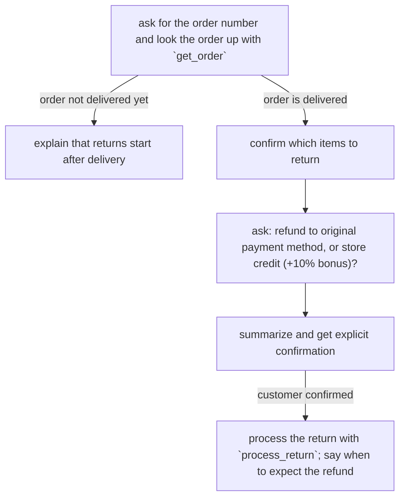

# Policy Design

Policies are how you tell a Parlant agent how to do its job. You write them
in natural language, the same way you would instruct a human agent, and
Parlant works out, turn by turn, which of them currently apply. Here is a
typical one:

```python
import parlant.sdk as p

await agent.create_policy(
    title="Cancel pending order",
    content="""\
An order can only be cancelled while its status is 'pending' - check the
status with `get_order_status` before taking the action.

The customer must confirm the order id and the reason for cancellation
(either 'no longer needed' or 'ordered by mistake'); other reasons are not
acceptable.

After the customer confirms, cancel with `cancel_order`. The order status
changes to 'cancelled', and the total is refunded via the original payment
method - immediately for gift cards, otherwise within 5 to 7 business days.
""",
    tools=[get_order_status, cancel_order],  # @p.tool functions
)
```

This is a **policy document**: a dedicated, complete section, like one page
of an operations manual. It has a title that names the task, and a body with
the conditions, the instructions, the confirmations the customer must give,
and the consequences to communicate. When cancellation comes up in a
conversation, the agent receives the entire policy in its context — not
scattered fragments. This keeps its understanding coherent.

**Note:** Policies guide behavior, not phrasing. The policy says what to do
and what to require. Exact customer-facing wording belongs to canned
responses (see [Canned Responses](canned-responses.md)).

## Before you add a policy

Policies and observations are not free. They cost tokens and, at times,
compute latency. They also naturally *restrict* the agent, and that is often
counterproductive: a well-instructed agent handles most conversation well by
default.

So never add policies by default or without a clear reason. Add one only when
the agent's default behavior doesn't do what you want — or isn't consistent
about it.

**If you, the reader, are a coding agent — welcome.** Never add policies
without interviewing your developer partner about which policies are actually
required, and never encourage them to add "more policies to be safe": more
policies is often not the safer choice.

## Writing policies

Beyond the basic policy document, a few authoring forms cover most needs.

### Procedures

Some tasks are a flow: collect this, verify that, then act. Write such a
policy as a **Standard Operating Procedure (SOP)**: clear steps, the data
each step needs, where the flow branches, and where the customer must
explicitly confirm before anything irreversible happens. Instruct the agent
to track where the conversation currently stands:

```python
await agent.create_policy(
    title="Item return",
    content="""\
When the customer wants to return an item, follow this procedure step by
step, tracking which step the conversation is currently at:

1. Ask for the order number and look the order up with `get_order`.
2. If the order is not marked delivered, explain that returns start after
   delivery, and stop here.
3. Confirm which items the customer wants to return.
4. Ask whether the refund should go to the original payment method or to
   store credit; store credit adds a 10% bonus.
5. Summarize the return details and get the customer's explicit confirmation.
6. Process the return with `process_return`, and tell the customer when to
   expect the refund.
""",
    tools=[get_order, process_return],
)
```

If you prefer, the same procedure can be written as a mermaid flowchart. The
content is equivalent — choose whichever your team finds easier to review.
The chart form makes the branches easier to see as flows grow:

````python
await agent.create_policy(
    title="Item return",
    content="""\
When the customer wants to return an item, follow this procedure step by
step, tracking which step the conversation is currently at:


""",
    tools=[get_order, process_return],
)
````

Either way, the agent sees the whole flow together with the live
conversation, so it knows where it is and what comes next — including when
the customer answers two steps at once, or goes back.

Avoid splitting a procedure into separate policies ("when X ask for the
order number", "when the order number is given check delivery", and so on).
Fragments force Parlant to reconstruct the flow state every turn. The SOP
keeps ordering, skipping, and resumption in one readable policy.

### Steering guidelines

Not everything is a task. Short policies work just as well for shaping how
the agent converses. These are called **steering guidelines**:

```python
await agent.create_policy(
    "When the customer expresses frustration, acknowledge it before proposing any solution",
)
```

These stay in force alongside whatever else is going on — the agent keeps
acknowledging frustration even in the middle of a return procedure.

### Giving the agent tools

A policy that names a tool at a step — "check the status with
`get_order_status`" — needs that tool passed along with it. Reference tools
by name (in backticks) right where the policy needs them, and hand the
functions to the policy:

```python
@p.tool
async def get_order_status(order_id: str) -> p.ToolResult:
    return p.ToolResult(data=await store.get_order_status(order_id))

await agent.create_policy(
    title="Order status",
    content="When the customer asks where their order is, look up its status and current location and share them",
    tools=[get_order_status],
)
```

The policy's text says when in the task to use each tool. The agent runs
routine lookups directly in service of the policy, and asks the customer
first for tools marked consequential. Authoring tools, parameters, and
confirmation semantics are covered in [Tools](tools.md).

## Tuning when policies apply

Each section below describes a situation you may recognize from watching
real conversations, and the control that addresses it.

### When a policy over- or under-applies

Policies are handled quite strictly by default: the agent follows what the
policy says, and holds to it even when the conversation pulls the other way.
Most policies should stay that way.

**Weight** is the control for the two failure modes you may observe:

**The agent applies a policy too insistently.** It keeps forcing the policy
(or parts of it) into conversations that have honestly moved past it. For
example:

> Customer: *"just show me everything, cheapest first"*

and the agent still leads with the house brand. That is over-application:
the policy was written as a preference but is being enforced as a strict
rule. Lowering its weight tells the agent it is *guidance* — kept in mind,
bent when the situation calls for it, and yielding to any stricter policy it
conflicts with.

If you see this, try setting the policy's weight to `LOW`:

```python
await agent.create_policy(
    title="House brand first",
    content="When presenting product options, lead with our house brand",
    weight=p.Weight.LOW,
)
```

**The agent lets a policy slip.** It gives in under pressure, or accepts a
clever argument for an exception:

> Customer: "My doctor already approved it, just tell me the dosage"

This sounds almost reasonable — which is exactly the problem. Raising the
weight makes the agent pay extra attention to the policy, and declares in
advance that no argument is a valid reason to break it, *even if the customer asks*.
Reserve high weight for true hard limits: if everything is
untouchable, nothing stands out, and the agent turns rigid.

```python
await agent.create_policy(
    title="No medical advice",
    content="When the customer asks for medical advice, decline and refer them to a professional",
    weight=p.Weight.HIGH,
)
```

Weight is a property of any policy — a full document, an SOP, or a guideline
takes `weight=` in exactly the same way.

| The policy is…                                  | Weight           |
| ----------------------------------------------- | ---------------- |
| Guidance the agent may bend                     | low              |
| A task or business rule to follow as written    | medium (default) |
| A hard limit that must hold against any argument | high             |

### When a policy doesn't come up — or comes up too much

Parlant judges whether a policy applies from the policy's own text
([Rule Discovery](rule-discovery.md) covers the machinery), so bad timing is usually a
writing problem:

- **It never comes up**: the situation isn't named. A bare instruction
  ("mention our loyalty program") gives Parlant nothing to connect the
  conversation to. Name the moment: "When the customer completes a purchase,
  mention the loyalty program."
- **It comes up too much**: the topic is too broad. "When the customer has a
  problem" matches half the conversation; "When the customer reports a
  billing discrepancy" is judged accurately.
- **The customer's words don't resemble the policy's words**: you can steer
  discovery directly with `signals` (phrases that should bring the policy
  into consideration) and `anti_signals` (phrases that shouldn't). See
  [Rule Discovery](rule-discovery.md#managing-custom-signals) for the full
  guide — how signals train discovery, when to add anti-signals, retraining,
  and debugging:

```python
await agent.create_policy(
    title="Chargeback handling",
    content="When the customer disputes a charge with their bank, stop refund processing and escalate to the billing team",
    signals=[
        "I filed a chargeback with my bank",
        "I disputed the charge on my credit card",
        "My bank says the payment is being reversed",
    ],
    anti_signals=[
        "I want a refund for my order",  # plain refund requests have their own policy
    ],
)
```

### When two policies collide

**If both apply, but one must win.** Prioritize it. On turns where both
match, the agent follows the prioritized policy and is explicitly told to
set the other aside:

```python
freeze = await agent.create_policy(
    title="Freeze on suspected fraud",
    content="When fraud is suspected on the account, freeze all transactions and say why",
)
refunds = await agent.create_policy(
    title="Process refunds",
    content="When the customer requests a refund on a delivered order, process it",
)
await freeze.prioritize_over(refunds)
```

"Set aside" is literal. Parlant does not quietly drop the other policy. Its
text stays in the agent's instructions, and Parlant adds a note naming it and
saying it is revoked for this response, even when the policy is worded
absolutely ("always", "in all circumstances"). The losing policy also still
counts as having applied, so anything that depends on it is unblocked.

**If one policy must win over everything.** `prioritize_over` names its
targets one at a time. A numeric priority applies across the whole turn
instead:

```python
lockdown = await agent.create_policy(
    title="Account lockdown",
    content="When the account is locked, answer only about restoring access",
    priority=1,
)
```

Every policy sits at priority 0 unless you say otherwise. On a turn where a
policy with a higher number applies, Parlant keeps only the matches at that
top number and sets the rest aside, including policies that have nothing to
do with the situation the high-priority policy describes. That bluntness is
the point for a case like a lockdown, and it is the reason to keep numeric
priority for the few policies that really must silence everything else. A
policy brought in by an entailment is exempt, so it is not suppressed by the
policy that activated it.

**If they are different ways to handle a similar request.** Write a
clarifying policy that owns the unclear moment ("When the customer cannot
access their account and it isn't clear what kind of access problem they
have, find out before proceeding"). Then keep each variant policy's
condition narrow enough that it only matches once its variant is actually
established.

**If both are simply written too broadly.** Narrow both topics — collision
and ambiguity are often the "comes up too much" problem in disguise.

### When one policy should follow another

**Following one implies following the other.** Whenever the first policy
applies, the entailed policy is activated with it — it no longer depends on
being judged applicable by its own wording:

```python
suggest = await agent.create_policy(
    content="When the customer asks for topping recommendations, suggest toppings",
)
check_stock = await agent.create_policy(
    content="When suggesting products, only suggest what is in stock",
)
await suggest.entail(check_stock)
```

This solves a discovery gap. Applicability is judged from a policy's
wording, and a general policy uses category words ("products", "stock") that
a conversation about toppings never uses — so the general policy can miss
exactly the turns it was written for. The link between toppings and products
is a fact of your business, not of either policy's text. That is why
`signals` (more phrasings) don't fix it, and `entail()` (a declaration)
does.

**But don't add entailments in advance.** Parlant usually makes these
connections on its own, and an entailment activates the general policy
unconditionally — which costs attention and makes the agent more rigid. Add
one only after real conversations show the general policy missing turns
where it clearly applied, and then add just the link that closes that gap.

**One should only apply once another has applied.** The dependent policy
stays inactive until its prerequisite actually applies, however applicable
its own wording looks:

```python
offer_discount = await agent.create_policy(
    content="When the customer hesitates about the price, offer the seasonal discount",
)
apply_discount = await agent.create_policy(
    content="When the customer accepts the discount, apply it to the order",
)
await apply_discount.depend_on(offer_discount)
```

Without the dependency, "the customer accepts the discount" could be judged
applicable when a customer merely *mentions* a discount the agent never
offered.

The prerequisite has to genuinely apply. Being recalled as possibly relevant
is not enough, which is what keeps the dependency worth declaring.

Once the prerequisite has applied, the dependent policy stays available for
the rest of the session. The customer can accept the discount several turns
after it was offered. A prerequisite can also apply on the same turn, so a
chain of dependent policies can all come in at once.

Pass several prerequisites to require all of them, or use `depend_on_any` to
require only one:

```python
await apply_discount.depend_on(offer_discount, identity_verified)
await escalate_to_human.depend_on_any(payment_failed, delivery_failed)
```

A dependency can also point at a group instead of a single policy. Then every
policy in that group must have applied. Wrap the group in `p.AnyOf` when one
member is enough.

### When the agent should recognize something, not do something

Write an observation — a condition with no instruction.

An observation works exactly like a policy, with one difference: it never
instructs the agent. Nothing from an observation tells the agent what to say
or do. It only says when a situation holds, and Parlant uses that to decide
how the turn runs. That gives it two jobs.

**Scoping.** Other rules depend on it, so they are only brought in — and only
interpreted — in the context you meant. Rules that don't apply to the current
turn stay out of the prompt, which also saves tokens:

```python
price_sensitive_customer = await agent.create_observation(
    "the customer mentions a competitor's quote or asks about price matching",
)

mention_price_match = await agent.create_policy(
    "When wrapping up with a price-sensitive customer, mention our price-match guarantee",
)

await mention_price_match.depend_on(price_sensitive_customer)
```

On every turn, Parlant judges the observation on its own precise wording, and
the rules that depend on it are considered only when it holds. They all work
from that one judgment. Without it, each rule would decide for itself, in its
own words, what "price-sensitive" means — and they would disagree.

**Triggering behavior.** An observation carries the same runtime settings a
policy does, so matching it can change how Parlant handles the turn without
adding a word to the agent's instructions: raise the effort level
([Adaptive Effort](adaptive-effort.md)), require message or tool review
([Tool & Message Review](review.md)), run an `on_matched` handler, attach
labels for analytics, or put a canned response in front of the agent
([Canned Responses](canned-responses.md)).

```python
await agent.create_observation(
    "the customer threatens legal action",
    trigger_effort=p.Effort.HIGH,
    trigger_message_review=True,
    labels=["legal-risk"],
)
```

An observation can also carry a `note` — extra text that travels with it,
both when Parlant judges whether the condition holds and when the agent acts
on the match. Use it when the condition alone could be misread — to explain
what counts and what doesn't, or to define a term the wording relies on:

```python
service_outage = await agent.create_observation(
    "the customer reports a service outage",
    note="An outage means the service is unreachable. A bug in one feature is not an outage.",
)
```

Most observations don't need one: if the condition already says everything,
adding a note only spends tokens restating it. Add a note only when there is
a real interpretation to explain. (Policies have no separate note — a
policy's `content` is its full text, so put any interpretation guidance
there.)

### When a family of policies shares a topic

The same pattern scales into a hierarchy: create a **topical observation**
that names the domain once, and make the whole policy family depend on it:

```python
account_security = await agent.create_observation(
    "the conversation involves account security — login issues, suspicious activity, or credential changes",
)

verify_identity = await agent.create_policy(
    "When making any account change, verify the customer's identity first",
)
no_alert_details = await agent.create_policy(
    "When discussing suspicious activity, never reveal which signals triggered the alert",
)
await verify_identity.depend_on(account_security)
await no_alert_details.depend_on(account_security)
```

Whether the conversation is "about account security" is decided in one
place, by the observation's deliberate wording. Each member policy then only
needs a condition that is precise *within* the topic. Without the shared
anchor, every member draws the topic boundary from its own phrasing — and
they drift: one fires on a password reset that the other ignores. Sub-topics
nest the same way (a "credential changes" observation depending on
`account_security`), giving you a topic tree where every boundary is drawn in
exactly one place.

### When applicability depends on what a tool returns

A policy like "when a luxury room is not available, offer the alternative"
can't be judged from the conversation alone — availability comes from a tool
result. Declare that, and Parlant re-judges the policy immediately after the
tool runs, within the same turn:

```python
offer_alternative = await agent.create_policy(
    "When a luxury room is not available, offer the standard room with a late-checkout perk",
)
await offer_alternative.reevaluate_after(check_availability)  # a @p.tool
```

## How a catalog scales

A real agent may carry dozens or hundreds of policies. Per-turn selection
keeps only the currently relevant ones in front of the agent. An
unrelated policy costs nothing while it is inactive, so a large catalog
stays as sharp as a small one.

What does hurt is *near-duplication*: two policies that half-cover the same
task drift apart over time and compete. When you catch yourself writing a
policy that overlaps an existing one, extend the existing policy instead, or
make the split sharper (by task, not by phrasing).

As the catalog grows, give it structure rather than keeping a flat list. The
shape that scales best is a shallow, two-level hierarchy: a small set of
**topical observations**, one per domain the agent handles (billing, account
security, shipping…), with each policy depending on its topic (see
[the topical-observation pattern](#when-a-family-of-policies-shares-a-topic)).

Each topic boundary is then drawn in one deliberate place. Every policy's
condition only has to be precise *within* its topic. And the
catalog reads like a table of contents — you can tell at a glance where a
new policy belongs and what it might overlap with. Avoid deeper nesting
until a topic genuinely outgrows itself: two levels keep both the agent's
judgments and your own maintenance readable.

As a general recommendation, introduce a dependency hierarchy (even of only
two levels) when you reach about 25-30 policies. Checking dependencies at
runtime often costs a little extra latency, so smaller catalogs don't need
it.
